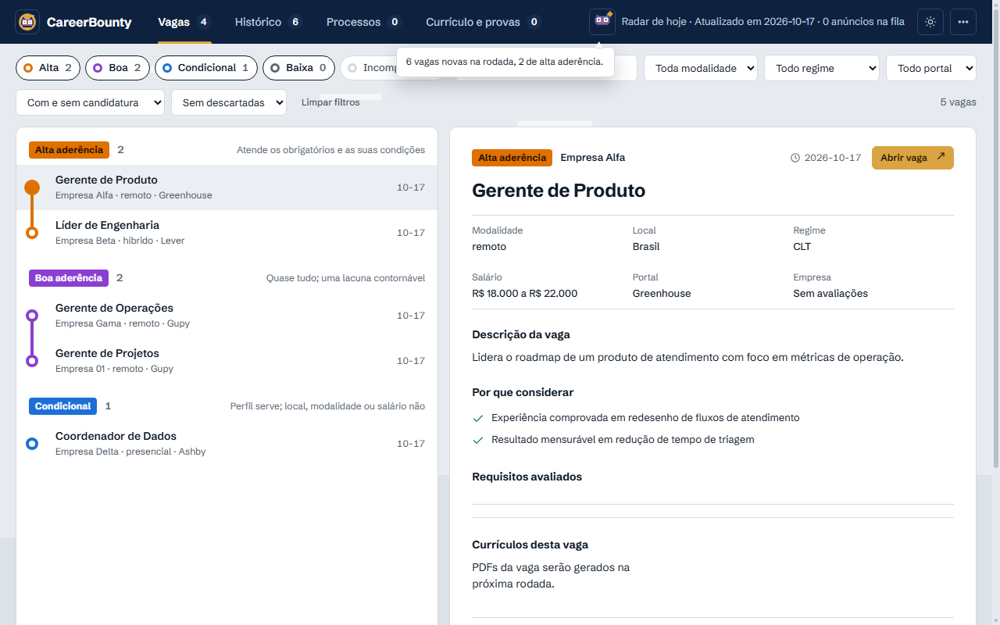
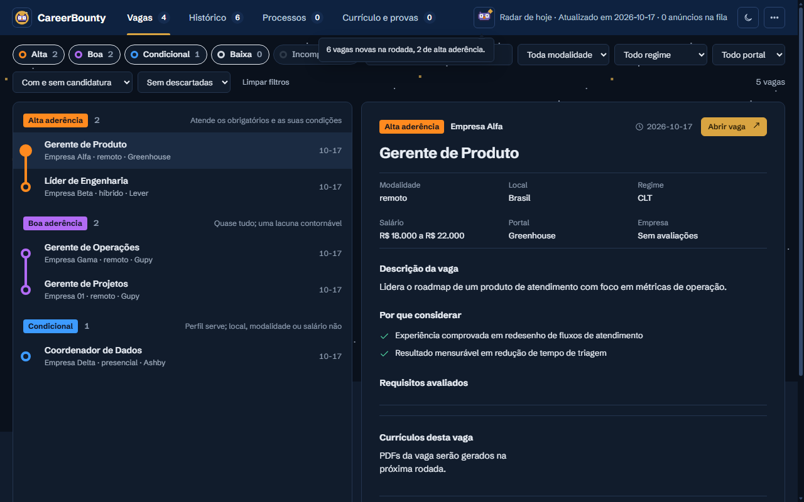
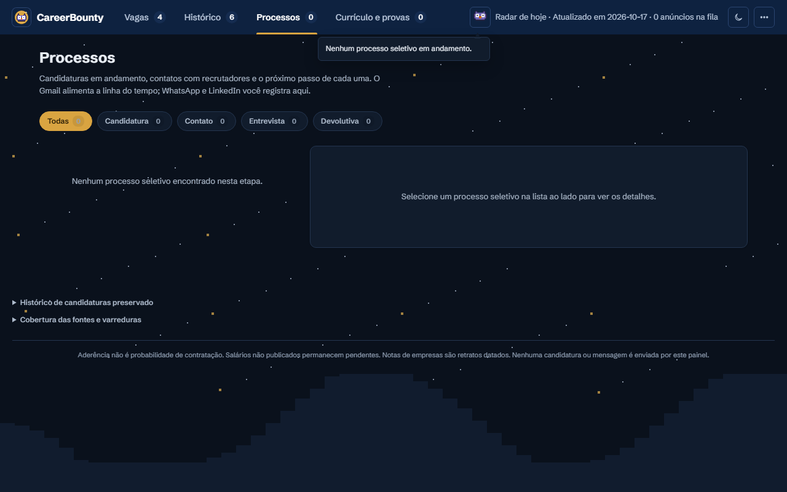

# CareerBounty <!-- sec:titulo -->

[](https://github.com/soulrocha/career-bounty/actions/workflows/ci.yml)
[](LICENSE)
[](https://nodejs.org)
[](package.json)

**Seu agente de busca de emprego dentro do Claude Code.** Encontra vagas, avalia o encaixe com a sua história, gera
currículos sob medida, prepara candidaturas e acompanha o processo seletivo pelo e-mail, sempre com você aprovando
o que sai em seu nome.

Leia antes o [aviso legal](LEGAL_DISCLAIMER.md): você responde pelos termos de uso de cada site, e o envio
automático vem desligado. English: [README.en.md](README.en.md).

<p align="center"></p>

| Tema claro | Tema escuro |
|---|---|
|  |  |

<sub>Capturas da demonstração com a persona fictícia, geradas por `node scripts/capturas-readme.mjs`.</sub>

## O que é <!-- sec:o-que-e -->

O CareerBounty junta três peças:

- **Uma CLI em Node** (`bin/career-bounty.mjs`) com toda a lógica determinística: coleta, deduplicação, notas,
  currículos, política de envio e trilha de auditoria. Funciona, e é testada, sem rede e sem modelo.
- **Comandos, skills e subagentes do Claude Code**, que fazem o trabalho de linguagem (triagem, redação de
  respostas, classificação de e-mail) e chamam a CLI para tudo o que precisa ser exato.
- **Um painel local** no navegador: vagas por aderência, processos seletivos com lembretes, histórico das candidaturas e
  a comparação entre o seu currículo e o que a sua base prova.

Seus dados ficam numa pasta privada fora do repositório. O repositório traz só código, documentação e uma persona
fictícia de exemplo.

## Destaques <!-- sec:destaques -->

- **Nada de fato inventado.** O modelo escolhe entre afirmações que você cadastrou, cada uma com nível de prova.
  Currículo com número sem evidência é bloqueado antes de chegar a você.
- **Você aprova, o hook garante.** O envio só acontece depois que você digita a frase exata do lote, e quem barra o
  resto é um hook do Claude Code, não a boa vontade do modelo.
- **Dois PDFs por vaga.** Um visual e um para ATS (coluna única), gerados do seu navegador, sem dependência de rede.
- **Auditável.** Tudo vira evento num log de acréscimo; painel e relatórios são projeções dele e podem ser reconstruídos.
- **Privado por construção.** Dados pessoais vivem em `DATA_ROOT`, fora do git, com varredura de privacidade no commit e
  na CI.
- **Seguro por padrão.** Envio automático desligado, LinkedIn guest desligado, limite diário, kill switch e trava para
  tentativa de resultado incerto.
- **Acompanhamento de processos.** Contatos com recrutadores (e-mail, WhatsApp, LinkedIn), etapas, devolutivas do Gmail
  e lembrete quando um processo passa de 5 a 7 dias sem resposta.
- **Preparação para entrevista.** Para cada vaga: pontos fortes com prova, lacunas, perguntas prováveis com as suas
  histórias STAR e o que não alegar.
- **Sem dependências npm.** Só Node 20+ e o Chrome ou Edge que você já tem.

## Demonstração <!-- sec:demo -->

Em dois comandos, sem tocar nos seus dados, você abre o painel com uma persona fictícia (Ana Exemplo) e seis vagas de
exemplo:

```sh
node bin/career-bounty.mjs demo
```

```text
Demonstração pronta em /tmp/career-bounty-demo (6 vagas de exemplo, persona fictícia).
Experimente:
  DATA_ROOT="/tmp/career-bounty-demo" node bin/career-bounty.mjs panel
  DATA_ROOT="/tmp/career-bounty-demo" node bin/career-bounty.mjs doctor
```

Rode o primeiro comando impresso (no PowerShell, a linha já vem com `$env:DATA_ROOT`) e abra o endereço que ele mostrar,
por padrão `http://127.0.0.1:8880`. A demo vive numa pasta temporária própria e recusa usar a sua `DATA_ROOT`. Apague a
pasta quando terminar.

## Como funciona <!-- sec:como-funciona -->

```text
 fontes de vagas ──► radar ──► triagem e nota ──► painel (Vagas)
                                    │
 base de carreira (kb) ─────────────┼──► currículo por vaga (2 PDFs + gates)
                                    │
                                    ▼
                         fila de candidatura ──► preparar no navegador ──► você aprova o lote ──► envio
                                                       │                                           │
                                     perguntas novas ──► painel (Perguntas)                comprovante
                                                                                                   │
 Gmail (só leitura) ──► classificação de e-mail ──► etapa do processo ◄─────────────────────────────┘
```

1. **Radar.** Coleta vagas de portais públicos e alertas, remove duplicatas e aplica filtros eliminatórios
   (local, modelo de trabalho, senioridade). Fonte com erro aparece como "não conferida", nunca como "sem vagas".
2. **Triagem.** Um subagente compara a vaga com a sua base de afirmações e devolve nota e motivos em JSON validado.
   O modelo escolhe entre afirmações existentes; não inventa fatos.
3. **Currículo.** Para cada vaga, gera um PDF visual e um PDF para ATS a partir das suas afirmações, com gates que
   bloqueiam número sem evidência, fato fora da base e texto fora do limite.
4. **Candidatura.** Abre a vaga numa aba nova do Chrome, preenche o formulário com o banco de respostas e para
   antes de enviar. Perguntas que ainda não têm resposta vão para o painel. O envio só acontece depois que você
   digita no chat a frase exata do lote ("enviar estas N: ...").
5. **Acompanhamento.** Lê os e-mails de processo seletivo pelo conector do Gmail, sem permissão de escrita, e
   atualiza a etapa de cada candidatura.

Tudo vira evento num log só de acréscimo (`DATA_ROOT/events`). Painel e relatórios são projeções desse log, então
qualquer estado pode ser reconstruído e auditado.

## Requisitos <!-- sec:requisitos -->

- Node 20 ou superior. Não há dependências npm.
- Claude Code, com a extensão Claude in Chrome para candidaturas e perfil de portal.
- Google Chrome ou Microsoft Edge instalado: os PDFs saem do modo headless do próprio navegador.
- Opcional: conector do Gmail no Claude Code, para o acompanhamento por e-mail.

## Instalação <!-- sec:instalacao -->

```sh
git clone https://github.com/soulrocha/career-bounty.git
cd career-bounty
npm test
```

`npm test` roda a suíte inteira, sem rede e sem modelo, e deve terminar sem falhas. Para chamar a CLI de qualquer pasta,
rode `npm link` (cria o comando `career-bounty`); sem isso, use `node bin/career-bounty.mjs` dentro do repositório.

Para usar os comandos, skills e hooks dentro do Claude Code, instale o plugin pelo marketplace do próprio repositório:

```text
/plugin marketplace add soulrocha/career-bounty
/plugin install career-bounty@career-bounty
```

## Primeiros passos <!-- sec:primeiros-passos -->

Cerca de 30 minutos, em ordem:

1. **Crie a pasta privada.** `node bin/career-bounty.mjs setup` monta o esqueleto de `DATA_ROOT` (padrão
   `~/.career-bounty`) e deixa o painel e a coleta prontos. Use `setup --com-legado` só se for migrar um pipeline
   antigo (veja [docs/PRONTIDAO.md](docs/PRONTIDAO.md)).
2. **Diga quem você é (para a privacidade).** Preencha `DATA_ROOT/identity.yml` com nome, e-mail, telefone e CPF. Eles
   nunca saem do seu computador: servem para o pre-commit e a varredura recusarem qualquer vazamento deles no git.
3. **Configure o radar.** Crie `DATA_ROOT/config.yml` (JSON válido) com o que você procura. Exemplo mínimo:

   ```json
   {
     "perfil": { "nome": "Seu Nome", "especialidade": "Produto e operações", "regiao": "Brasil" },
     "radar": {
       "termos": ["gerente de produto", "líder de produto"],
       "criterios": { "titulos_alvo": ["gerente", "líder"], "palavras_negativas": ["estágio", "júnior"] }
     },
     "fontes": { "gupy": {} }
   }
   ```

   Cada fonte listada em `fontes` entra na coleta. Todas as chaves estão em [Configuração](#configuração).
4. **Alimente a base de carreira.** Coloque suas realizações em `DATA_ROOT/kb` (uma afirmação por arquivo, com nível de
   prova) e rode `node bin/career-bounty.mjs kb sync`. Use `examples/persona-ficticia/` como molde. Lacunas viram
   perguntas com `/entrevista`. Detalhes em [docs/KNOWLEDGE.md](docs/KNOWLEDGE.md).
5. **Monte o perfil de currículo.** Crie `DATA_ROOT/cv/perfil.json` (contato, cabeçalho, foto opcional, cartões e
   experiências, cada um ligado às suas afirmações). O formato está em [docs/CV.md](docs/CV.md).
6. **Confira.** `node bin/career-bounty.mjs doctor` lista o que falta, sem alterar nada. Os avisos são o seu roteiro.
7. **Rode o primeiro radar.** `node bin/career-bounty.mjs collect --dry-run` mostra o que há de novo sem gravar. Se o
   resultado fizer sentido, rode `collect` e abra o painel (`panel`).

## Seus dados ficam separados <!-- sec:dados -->

O repositório é só código. Tudo que é seu mora em `DATA_ROOT`, uma pasta própria que **nunca** entra no git:

| Pasta ou arquivo | O que guarda |
|---|---|
| `config.yml` | Sua configuração (o que procurar, limites, aceites) |
| `identity.yml` | Nome, e-mail, telefone e CPF, usados só para barrar vazamento |
| `kb/` | Suas afirmações, evidências, histórias e perfil de carreira |
| `cv/` | `perfil.json`, foto e a proposta de perfil de portal |
| `events/`, `projections/`, `state/` | O log de eventos e o que é derivado dele |
| `artifacts/` | PDFs e comprovantes gerados |
| `secrets/` | Tokens, só para você |
| `outbox/` | Propostas que esperam a sua revisão |

Essa separação é proposital: o código evolui sem risco de levar dado pessoal junto, você pode versionar, publicar e
atualizar o programa à vontade, e consertar um comportamento nunca mexe nos seus dados. Troque de máquina copiando só a
pasta `DATA_ROOT`. Um pre-commit e a CI bloqueiam CPF, telefone, caminho de usuário e os valores do seu `identity.yml`.

## Uso no dia a dia <!-- sec:uso -->

### Radar de vagas <!-- sec:uso-radar -->

`/radar` roda a coleta, a deduplicação e os filtros e mostra o resumo da rodada. Pela CLI:
`collect --dry-run` mostra o que há de novo sem gravar, `collect` grava e `digest` resume. `schedule` gera a
tarefa agendada do Windows que roda o radar uma vez por dia. As fontes estão em
[docs/SOURCES.md](docs/SOURCES.md).

### Painel <!-- sec:uso-painel -->

`/painel` (ou `panel`) abre o painel em `http://127.0.0.1:8880`. Ele só aceita acesso pela própria máquina e
exige token nas gravações. Abas:

| Aba | Para quê |
|---|---|
| Vagas | Vagas agrupadas por aderência, detalhe ao lado, nota da empresa, currículos da vaga (visual e ATS, ou o perfil Gupy) e atalhos J/K/A/D/O |
| Histórico | Todas as candidaturas e como terminaram, com a linha do tempo de cada vaga |
| Processos | Processos em andamento como uma linha de quatro estações, contatos, o que pede acompanhamento e a preparação para entrevista |
| Currículo e provas | Matriz "está no CV / fora do CV" × "tem dado / não tem dado", com ações que movem cada item |

No menu ⋯ ficam as respostas de formulário (perguntas pendentes da candidatura assistida e as já salvas), as fontes da rodada,
o perfil do LinkedIn e a pausa da animação do fundo.



### Currículos <!-- sec:uso-cv -->

`cv gerar --vaga <id>` produz os dois PDFs da vaga em `DATA_ROOT/artifacts/cv/<vaga>/<hash>/` e roda os gates.
`cv gate --vaga <id>` reavalia uma versão existente. Versão bloqueada nunca é oferecida para anexo. Para portais
que usam o perfil como currículo, `cv perfil-portal` propõe o texto do perfil.

### Candidaturas <!-- sec:uso-candidaturas -->

`/aplicar` trabalha a fila em lotes curtos:

1. `apply plan` escolhe as vagas elegíveis e a rota de cada uma.
2. Para cada vaga, o agente abre uma aba nova, roda o extrator de campos e `apply preparar`, que casa cada campo com
   o banco de respostas. Dado sensível (salário, documentos, deficiência) fica para você preencher.
3. `apply lote` monta a frase do lote. Só quando você a digita no chat o hook libera o clique de envio, uma vaga
   por vez, com aprovação válida por 2 horas e de uso único.
4. `apply comprovante` e `apply desfecho` registram o resultado e o comprovante.

Login, captcha e verificação em duas etapas param a vaga e devolvem a aba para você.

### Gupy <!-- sec:uso-gupy -->

Na Gupy o perfil é o currículo. Duas skills cuidam disso:

- **`gupy-perfil`** lê o seu perfil, propõe mudanças item a item e só grava o item que você aprovar com
  "aprovar perfil <hash>". Veja [docs/GUPY-PERFIL.md](docs/GUPY-PERFIL.md).
- **`gupy-candidatar`** responde as perguntas da vaga e para antes de testes, vídeos e agendamentos.

A rota Gupy exige `"gupy": { "aceite_termos": true }` no `config.yml` e respeita o limite diário
`gupy.max_por_dia` (padrão 5).

### E-mail e acompanhamento <!-- sec:uso-email -->

`/email` lê as mensagens de processo seletivo pelo conector do Gmail e atualiza a etapa de cada candidatura
(inscrita, nova etapa, entrevista, oferta ou encerramento). Um hook nega qualquer ferramenta de escrita do Gmail.

### Processos, contatos e lembretes <!-- sec:uso-processos -->

- `contato registrar` guarda um contato de recrutador (e-mail, WhatsApp, LinkedIn ou telefone), com resumo, pergunta e
  próxima etapa. `contato sugerir` gera o rascunho de resposta a partir das suas afirmações, em `outbox/`, e nunca envia.
- `processo etapa` e `processo encerrar` registram o andamento e o desfecho de cada vaga.
- `acompanhamento pendentes` lista o que está há 5 dias ou mais sem movimento (aviso) e 7 ou mais (lembrete). O resumo
  do dia (`digest`) inclui essa lista.
- O telefone e o e-mail de quem você registra são mascarados antes de qualquer tela.

### Empresas <!-- sec:uso-empresas -->

`/empresa <nome>` faz a pesquisa na web pela nota de avaliação de funcionários e grava nota, quantidade, plataforma, data
e fonte (`empresa avaliar --resultados`). O CareerBounty não raspa o Glassdoor. Sem fonte com link, a nota é recusada. Para
registrar à mão: `empresa registrar --empresa --nota --quantidade --fonte <url>`. A nota é um retrato datado e vale 90 dias.

### Preparação para entrevista <!-- sec:uso-preparacao -->

`entrevista preparar --vaga <id>` (ou `preparar-entrevista`) grava em `outbox/entrevistas/` os pontos fortes com prova, as
lacunas e como tratá-las, as perguntas prováveis com as suas histórias STAR e o que não alegar. A parte de uma história que
não está registrada aparece marcada para você completar, nunca inventada. `entrevista simular` gera o roteiro para treinar.

### Perfil do LinkedIn <!-- sec:uso-linkedin -->

Copie o perfil atual para `DATA_ROOT/cv/perfil-linkedin.json` e rode `cv perfil-portal --portal linkedin --live`: sai uma
proposta campo a campo (título, sobre, experiências e competências), com o texto atual, o proposto e as afirmações que
sustentam cada mudança. Nada é aplicado no site.

### Currículo e provas, entrevista de lacunas e mentor <!-- sec:uso-carreira -->

- `/quadrantes` calcula a comparação entre o seu currículo e o que a sua base prova, e grava o relatório. No painel, a aba
  Currículo e provas mostra o mesmo, com ações (`analise incluir`, `analise marcar`, `analise lacuna`).
- `/entrevista` pergunta sobre as lacunas da sua base. Cada resposta vira uma afirmação que você aprova.
- `/mentor` conversa sobre funil, posicionamento e próximos passos, só com leitura.

## Comandos <!-- sec:comandos -->

Comandos do Claude Code:

| Comando | O que faz |
|---|---|
| `/setup` | Cria o esqueleto de `DATA_ROOT` |
| `/doctor` | Diagnostica o ambiente sem alterar nada |
| `/radar` | Coleta, deduplica, filtra e resume as vagas |
| `/painel` | Abre o painel local |
| `/aplicar` | Candidatura assistida na fila elegível |
| `/email` | Acompanha o processo seletivo pelo Gmail |
| `/empresa` | Pesquisa e grava a nota da empresa, com fonte |
| `/quadrantes` | Relatório de currículo e provas |
| `/entrevista` | Entrevista de lacunas da base de carreira |
| `/mentor` | Conversa de carreira |

Subcomandos da CLI (`node bin/career-bounty.mjs <comando> [--json]`):

| Grupo | Subcomandos |
|---|---|
| Ambiente | `setup`, `demo`, `doctor`, `help`, `plugin validate`, `privacy scan` |
| Vagas | `collect`, `digest`, `daily-run`, `schedule`, `destinos`, `compare-radar`, `preferencias` |
| Base de carreira | `kb`, `quadrantes`, `analise`, `entrevista`, `preparar-entrevista`, `mentor`, `report`, `vault plan` |
| Processos | `contato`, `processo`, `acompanhamento`, `empresa` |
| Currículos | `cv gerar`, `cv gate`, `cv perfil-portal [--portal gupy\|linkedin]` |
| Candidaturas | `apply plan`, `apply preparar`, `apply lote`, `apply envio`, `apply comprovante`, `apply desfecho` |
| Gupy | `gupy perfil iniciar`, `propor`, `confirmar`, `encerrar` |
| Envio automático | `envio pausar`, `envio retomar`, `envio audit [--dia AAAA-MM-DD]` |
| E-mail | `mail` |
| Dados | `migrate`, `project`, `verify`, `panel`, `eval` |

Com `--json`, a saída, inclusive erro, sai como JSON no stdout. Erro de uso termina com código 2.

## Uso com Codex e Antigravity <!-- sec:outros-agentes -->

A CLI funciona em qualquer agente que rode comandos: o [`AGENTS.md`](AGENTS.md) explica ao Codex e ao Antigravity como
rodar radar, currículos, processos e painel, e as regras de segurança. Comandos, skills e hooks são do Claude Code. Os hooks
que protegem a candidatura assistida (frase do lote, uma vaga por vez, Gmail só leitura) só rodam no Claude Code: em outro
agente, use o CareerBounty para busca, currículo, processos e painel, e faça a candidatura assistida no Claude Code.

Busca no LinkedIn: o caminho seguro são os alertas de vaga do LinkedIn que chegam ao seu e-mail (fonte
`linkedin_alertas`). O coletor guest vem desligado e exige `aceite_termos: true`, porque pode violar os termos de uso do
site. Nenhum agente deve automatizar o LinkedIn logado em seu nome.

## Configuração <!-- sec:configuracao -->

A configuração pessoal vive só em `DATA_ROOT/config.yml` (JSON válido). Veja `config.example.yml`. Os padrões são
seguros:

| Chave | Padrão | Efeito |
|---|---|---|
| `perfil.nome`, `.especialidade`, `.regiao` | vazio | Identificação mostrada no painel |
| `radar.termos` | `[]` | Termos de busca nas fontes |
| `radar.criterios` | `{}` | `titulos_alvo`, `palavras_chave`, `palavras_negativas`, `regiao_presencial`, `corte_prescore` e faixas de salário (`clt`, `pj`), só como referência de negociação: salário não descarta vaga |
| `radar.criterios.modalidades` | as três | Modalidades aceitas (`remoto`, `hibrido`, `presencial`); vaga em outra é descartada. O `/setup` pergunta e grava pelo comando `preferencias` |
| `radar.criterios.modalidade_preferida` | nenhuma | A preferida pontua mais na triagem |
| `radar.janela_dias` | `7` | Quantos dias para trás cada coleta olha |
| `fontes.<id>` | nenhuma | Cada fonte com bloco entra na coleta: `gupy`, `freehire`, `inhire`, `solides`, `jobspy`, `careerops`, `linkedin_alertas` |
| `envio.padrao` | `parar_antes_de_enviar` | Toda candidatura para antes do clique final |
| `envio.regras` | `[]` | Regras de envio automático por portal (veja [Estado do projeto](#estado-do-projeto)) |
| `gupy.aceite_termos` | `false` | Sem aceite, a rota Gupy recusa |
| `gupy.max_por_dia` | `5` | Teto diário de envios na Gupy |
| `cv_skip_portals` | `["gupy"]` | Portais que não recebem PDF anexado |
| `fontes.linkedin_guest.ativo` | `false` | Coletor guest do LinkedIn desligado; ligar exige `aceite_termos: true` |
| `mail.ativo` | `false` | Acompanhamento por e-mail |
| `panel.port` | `8880` | Porta do painel local |

## Arquitetura <!-- sec:arquitetura -->

| Camada | Onde | Papel |
|---|---|---|
| Interface | `commands/`, `skills/`, `panel/`, `hooks/` | Entradas finas: chamam a CLI ou delegam a subagentes |
| Subagentes | `agents/` | Trabalho de linguagem com modelo e ferramentas explícitos; devolvem JSON validado |
| Núcleo | `core/` | Lógica determinística, testável sem rede e sem modelo |
| Dados | `DATA_ROOT` | Configuração, base, eventos, projeções e artefatos, fora do git |

Módulos do núcleo:

| Módulo | Responsabilidade |
|---|---|
| `store` | Log de eventos, locks e projeções |
| `sources`, `radar`, `dedup`, `score` | Coleta, deduplicação, filtros e nota |
| `kb` | Fontes de conhecimento e afirmações |
| `cv` | Seleção de afirmações, renderização, PDFs e gates |
| `apply` | Fila, banco de respostas, preenchimento, aprovação, política e drivers |
| `browser` | Cliente CDP mínimo para o Chrome ou o Edge, sem Playwright |
| `mail` | Contrato, classificação e efeitos do e-mail |
| `llm` | Execução de subagentes nos modos fake, replay e live |
| `hooks` | Decisões dos hooks do Claude Code |
| `privacy`, `plugin`, `doctor` | Varredura de privacidade, validação do pacote e diagnóstico |
| `migration`, `schedule`, `eval` | Importação do legado, rotina diária e avaliação dos agentes |

Os hooks são a barreira de segurança. Eles não dependem do modelo obedecer:

- **PreToolUse:** nega escrita no Gmail. Na aba de candidatura, nega clique por coordenada, Enter e script que não
  seja do CareerBounty, e libera o envio só com aprovação válida. Na aba de perfil, libera só o item aprovado.
- **PostToolUse:** registra o que a página realmente mostrou (etapa da Gupy, leitura do perfil). O modelo não
  declara esses estados.
- **UserPromptSubmit:** reconhece a frase do lote e a aprovação de perfil, digitadas por você.
- **SessionStart:** resume as pendências ao abrir a sessão.

Decisões de desenho estão em [docs/adr/](docs/adr/), e o detalhe das camadas e das fronteiras de teste está em
[docs/ARCHITECTURE.md](docs/ARCHITECTURE.md).

## Segurança e limites <!-- sec:seguranca -->

- O envio assistido nunca acontece sem a frase do lote digitada por você. A aprovação vale para uma vaga, por 2 horas,
  uma vez.
- Tentativa com resultado incerto não é repetida: fica pendente até o e-mail ou você confirmar, e consome o limite do dia.
- O envio automático, quando ligado, só atua em formulários públicos de Greenhouse, Lever e Ashby, em navegador sem
  login nem cookies, nas origens `https` desses portais, com limite diário, kill switch conferido de novo antes do clique
  e aprovação amarrada ao hash do PDF e das respostas. `envio pausar` o interrompe na hora.
- Testes, vídeos e agendamentos ficam sempre com você.
- O painel só escuta em loopback, com CSP restritiva e token efêmero.
- O modelo nunca roda em `npm test`; os testes usam saídas fabricadas e gravações reproduzíveis.

Para reportar uma falha de segurança, veja [SECURITY.md](SECURITY.md).

## Privacidade <!-- sec:privacidade -->

Nada pessoal entra no git. Um pre-commit bloqueia CPF, telefone, caminho de usuário, valores da sua identidade e
empresas da sua denylist, e `privacy scan --all` varre o repositório inteiro. Veja [PRIVACY.md](PRIVACY.md).

## Estado do projeto <!-- sec:estado -->

Versão **0.2.0**, a primeira para uso real. Veja o [CHANGELOG](CHANGELOG.md).

| Parte | Estado |
|---|---|
| Fundação, painel, radar, base de carreira e e-mail | Pronto |
| Currículos com gates | Pronto |
| Candidatura assistida, perguntas no painel e perfil e candidatura na Gupy | Pronto |
| Envio automático por política (Greenhouse, Lever, Ashby) | Motor, drivers e kill switch prontos e testados; ainda sem comando que o dispare, e desligado por padrão |
| Instalação nova e demonstração | Pronto |
| Migração de um pipeline antigo (modo sombra e corte) | Pronto, para quem já usava uma ferramenta anterior |

A promoção para 1.0 depende de um ciclo de uso real. Se algo não bate com o que você vê, abra uma issue.

## Desenvolvimento <!-- sec:desenvolvimento -->

`npm test` roda a suíte com `node --test`. Cada fatia começa pelo teste que prova o critério de aceite. A CI roda em
Ubuntu e Windows, com varredura de privacidade e de segredos. Veja [CONTRIBUTING.md](CONTRIBUTING.md),
[SECURITY.md](SECURITY.md) e [docs/SETUP.md](docs/SETUP.md).

## Licença <!-- sec:licenca -->

MIT. Veja [LICENSE](LICENSE) e [NOTICE](NOTICE).
