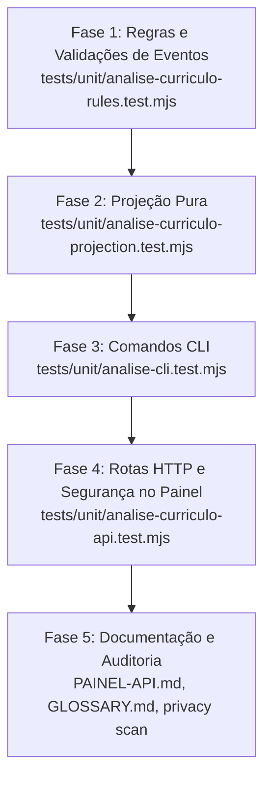

# Arquitetura e Especificação Técnica: Fatia F9.5 — Análise do Currículo contra a Base (`analise-curriculo`)

> **Status:** Especificação técnica detalhada para implementação via TDD.  
> **Referência de Requisitos:** `<VAULT_ROOT>/.tarefas/career-bounty/PLANO-F9-recursos-2026-10-18.md` (seção F9.5 e regras globais).  
> **Design de Referência:** `docs/design/PAINEL.md` (seção "Matriz de Currículo e provas").  
> **Branch de Trabalho:** `feat/F9.5-analise-curriculo` no repositório `C:\Projetos\career-bounty-backend`.

---

## 1. Visão Geral da Fatia F9.5

A fatia **F9.5** moderniza e padroniza a antiga aba "Quadrantes", transformando-a na **Análise do Currículo contra a Base** (identificador técnico: `analise-curriculo`):

1. **Adequação Conceitual e de Vocabulário:**
   - O termo "Quadrantes" é descontinuado na interface e no vocabulário público em favor de **Currículo e Provas** (ou `analise-curriculo` como identificador de sistema/API).
   - A matriz de 2x2 organiza os itens com base nos eixos:
     - Eixo Vertical: **Está no CV** vs. **Fora do CV**.
     - Eixo Horizontal: **Tem prova documental / fato comprovado** vs. **Sem prova / não comprovado**.
   - Os quatro grupos ganham nomenclaturas semânticas estáveis:
     - `confere` (antigo quadrante a): Fatos e números citados no CV que batem com afirmações comprovadas.
     - `sem_prova` (antigo quadrante c): Itens citados no CV sem afirmação vinculada (`sem_marca`), com números divergentes/órfãos ou sustentados apenas por relato/proposta sem prova.
     - `fora_do_cv` (antigo quadrante b): Afirmações com prova (`verificado` ou `entregue`) liberadas para uso em CV que nenhum bullet do currículo cita atualmente, além de arcos/histórias sem afirmações vinculadas.
     - `lacuna` (antigo quadrante d): Faltas detectadas na base (afirmações sem evidência, resultados sem linha de base, buracos temporais e requisitos frequentes de vagas de interesse não atendidos).

2. **Formato Uniforme e Determinístico de Itens:**
   - Cada item exposto pela projeção em qualquer um dos 4 grupos adota uma estrutura estrita e padronizada com identificador estável (`id`), descrição factual (`texto`), referências de afirmações (`afirmacoes[]`), referências de evidências (`evidencias[]`), nível de sustentação (`nivel_prova`), motivo da classificação (`motivo`), pergunta de esclarecimento/ação (`pergunta`), peso de relevância (`peso`) e estado operacional (`status`).

3. **Event Sourcing Puro e Ações Auditáveis:**
   - Nenhuma ação da pessoa usuária modifica arquivos da base ou do perfil às escondidas.
   - Três novos tipos de eventos no log append-only (`events/`):
     - `analise.afirmacao_incluida`: Registra a intenção de ligar uma afirmação de `fora_do_cv` a uma experiência do `cv/perfil.json`.
     - `analise.item_marcado`: Registra anotação operacional de um item (`status: 'revisar' | 'ignorado'`), com justificativa opcional.
     - `analise.lacuna_entrevista`: Dispara a criação de proposta/roteiro de entrevista para resolução da lacuna em `outbox/lacunas/` ou `outbox/entrevistas/` e grava o evento auditável correspondente.

4. **Operações por CLI e API Local Segura:**
   - Comandos da CLI em `core/cli/analise.mjs`: `analise listar`, `analise incluir`, `analise marcar` e `analise lacuna`.
   - Endpoints HTTP no servidor local do painel (`panel/server.mjs`):
     - `GET /api/analise-curriculo`: Consulta completa autenticada com mascaramento de PII.
     - `POST /api/analise-curriculo/incluir`: Vinculação de afirmação a experiência.
     - `POST /api/analise-curriculo/marcar`: Marcação de revisão ou descarte lógico.
     - `POST /api/analise-curriculo/entrevista`: Geração de pergunta para rascunho de entrevista.
   - Proteção estrita contra CSRF/cross-origin no painel local (validação rigorosa de `Origin`, `Host` e `X-Painel-Token`).

---

## 2. Modelo de Dados Uniforme e Projeção Pura

### 2.1 Especificação do Item Uniforme

Todos os itens devolvidos nos quatro grupos (`confere`, `sem_prova`, `fora_do_cv`, `lacuna`) devem implementar estritamente a seguinte interface:

```typescript
interface ItemAnaliseCurriculo {
  id: string;               // Identificador único determinístico e estável
  grupo: 'confere' | 'sem_prova' | 'fora_do_cv' | 'lacuna';
  tipo_origem: string;      // 'cv_bullet' | 'afirmacao' | 'arco' | 'lacuna_fonte' | 'lacuna_linha_base' | 'lacuna_timeline' | 'lacuna_vagas'
  texto: string;            // Texto ou descrição factual limpa
  afirmacoes: string[];     // IDs de afirmações vinculadas (ex: ['AF-001'])
  evidencias: string[];     // IDs de evidências que cobrem as afirmações (ex: ['EV-010'])
  nivel_prova: 'verificado' | 'entregue' | 'relato' | 'proposta' | 'nenhum';
  motivo: string;           // Explicação/diagnóstico do porquê o item está classificado aqui
  pergunta: string | null;  // Pergunta sugerida para esclarecimento/entrevista ou null
  peso: number;             // Inteiro determinístico de severidade/relevância
  status: 'ativo' | 'revisar' | 'ignorado';
  inclusao?: {              // Presente se afetado por evento analise.afirmacao_incluida
    incluida: boolean;
    experiencia_id: string | null;
    data: string;
  } | null;
  entrevista?: {            // Presente se afetado por evento analise.lacuna_entrevista
    pergunta: string;
    data: string;
    arquivo_rascunho: string | null;
  } | null;
}
```

### 2.2 Regras Determinísticas de Formação do `id` Estável

Para permitir que a pessoa usuária e as chamadas de API façam referência direta aos itens sem depender de índices transitórios de tela, os IDs seguem regras determinísticas padronizadas:

1. **Grupo `confere` (antigo quadrante a):**
   - Bullet de CV vinculado a afirmações comprovadas.
   - Padrão: `confere:claim:${item.claim_ids[0]}` quando a afirmação for citada uma única vez no modelo, ou `confere:${item.modelo || 'cv'}:linha:${item.linha}` se não houver `claim_ids` ou houver colisão de claims no mesmo modelo.
   - Exemplo estável: `confere:claim:AF-012` ou `confere:cv-padrao:linha:18`.

2. **Grupo `sem_prova` (antigo quadrante c):**
   - Bullet do CV que não confere, possui número divergente/órfão ou carece de marcação de prova.
   - Padrão: `sem_prova:${item.modelo || 'cv'}:linha:${item.linha}`.
   - Exemplo estável: `sem_prova:cv:linha:4` ou `sem_prova:modelo-ats:linha:25`.

3. **Grupo `fora_do_cv` (antigo quadrante b):**
   - Afirmação com prova liberada para CV não citada: `fora_do_cv:af:${item.id}` (ex.: `fora_do_cv:af:AF-034`).
   - Arco/história sem afirmação vinculada: `fora_do_cv:arco:${item.id}` (ex.: `fora_do_cv:arco:AR-003`).

4. **Grupo `lacuna` (antigo quadrante d):**
   - Lacuna gerada pelo motor `core/kb/gaps.mjs` (onde o identificador semântico já é `sem_fonte:ID`, `sem_linha_base:ID`, `buraco_timeline:PERIODO` ou `requisito_frequente:TERMO`).
   - Padrão: `lacuna:${item.id}`.
   - Exemplo estável: `lacuna:sem_fonte:AF-001`, `lacuna:sem_linha_base:AF-022`, `lacuna:buraco_timeline:2020-01..2020-08`, `lacuna:requisito_frequente:kubernetes`.
   - *Nota de tolerância:* Comandos CLI e endpoints aceitam tanto o ID completo com prefixo `lacuna:` quanto o ID base (`sem_fonte:AF-001`).

### 2.3 Mapeamento de Atributos por Grupo

| Grupo | `texto` | `afirmacoes` | `evidencias` | `nivel_prova` | `motivo` | `pergunta` | `peso` |
| :--- | :--- | :--- | :--- | :--- | :--- | :--- | :--- |
| **`confere`** | `item.texto` | `item.claim_ids` | Evidências vinculadas às afirmações | Menor nível entre afirmações vinculadas (`verificado` ou `entregue`) | Justificativa de correspondência com a base | `null` | 2 se `verificado`, 1 se `entregue` |
| **`sem_prova`** | `item.texto` | `item.claim_ids ?? []` | Evidências vinculadas (se houver) | Nível da afirmação vinculada (`relato`, `proposta`) ou `'nenhum'` se `sem_marca` | Diagnóstico de incongruência (`item.motivo`) | Pergunta de esclarecimento sobre comprovação | 5 se número divergente/órfão, 4 se afirmação sem prova, 3 se bullet sem marca |
| **`fora_do_cv`** | `item.texto` (afirmação) ou título do arco | `[item.id]` (afirmação) ou `[]` (arco) | Evidências vinculadas à afirmação | Nível da afirmação (`verificado`/`entregue`) ou `'nenhum'` para arco | Afirmação com prova não aproveitada no CV atual | Pergunta sugerindo experiência para inclusão | 3 se `verificado`, 2 se `entregue`, 1 se arco |
| **`lacuna`** | `item.descricao` | `[item.alvo]` se for afirmação, senão `[]` | `[]` | Nível da afirmação alvo (se aplicável) ou `'nenhum'` | Diagnóstico da lacuna identificada | `item.pergunta_sugerida` | `item.peso` (calculado por `gaps.mjs`) |

### 2.4 Resolução Reativa de Status via Event Sourcing

O status inicial de todo item é `'ativo'`.
A projeção pura processa a sequência de eventos cronológicos:
1. `analise.item_marcado`:
   - Atualiza `item.status` para `d.como` (`'revisar'` ou `'ignorado'`).
   - Se o mesmo item receber múltiplas marcações posteriores, o evento mais recente prevalece.
2. `analise.afirmacao_incluida`:
   - Localiza o item correspondente em `fora_do_cv` (`fora_do_cv:af:${d.afirmacao_id}`).
   - Anexa o objeto `inclusao: { incluida: true, experiencia_id: d.experiencia_id ?? null, data: d.data }`.
3. `analise.lacuna_entrevista`:
   - Localiza a lacuna correspondente (`lacuna:${d.item_id}` ou `d.item_id`).
   - Anexa o objeto `entrevista: { pergunta: d.pergunta, data: d.data, arquivo_rascunho: d.arquivo_rascunho ?? null }`.

### 2.5 Arquivo da Projeção Pura: `core/store/projections/analiseCurriculo.mjs`

Criar o módulo dedicado com a função de projeção pura:

```javascript
// core/store/projections/analiseCurriculo.mjs
// Projeção pura e determinística da Análise de Currículo contra a Base (F9.5).

export function projectAnaliseCurriculo({ quadrantes, evidencias = [], eventos = [], now = new Date() }) {
  // 1. Processar histórico de eventos de análise
  const marcacoes = new Map();
  const inclusoes = new Map();
  const entrevistas = new Map();

  for (const evento of eventos ?? []) {
    if (!evento?.tipo?.startsWith('analise.')) continue;
    const d = evento.dados;
    if (!d) continue;

    if (evento.tipo === 'analise.item_marcado') {
      marcacoes.set(d.item_id, { status: d.como, motivo: d.motivo ?? null, data: d.data, ts: evento.ts });
    } else if (evento.tipo === 'analise.afirmacao_incluida') {
      inclusoes.set(d.afirmacao_id, { experiencia_id: d.experiencia_id ?? null, data: d.data, ts: evento.ts });
    } else if (evento.tipo === 'analise.lacuna_entrevista') {
      entrevistas.set(d.item_id, { pergunta: d.pergunta, data: d.data, arquivo_rascunho: d.arquivo_rascunho ?? null, ts: evento.ts });
    }
  }

  // 2. Mapa inverso de evidências por afirmação
  const evidenciasPorAfirmacao = new Map();
  for (const ev of evidencias) {
    for (const afId of ev.afirmacoes ?? []) {
      if (!evidenciasPorAfirmacao.has(afId)) evidenciasPorAfirmacao.set(afId, new Set());
      evidenciasPorAfirmacao.get(afId).add(ev.id);
    }
  }

  // 3. Funções auxiliares para montagem uniforme de itens
  // ... (mapeamento de cada um dos 4 grupos)

  // 4. Agregação e cálculo de contadores determinísticos
  // ...
  return {
    grupos: {
      confere: itensConfere,
      sem_prova: itensSemProva,
      fora_do_cv: itensForaDoCv,
      lacuna: itensLacuna,
    },
    contadores: {
      total: todosItens.length,
      confere: itensConfere.length,
      sem_prova: itensSemProva.length,
      fora_do_cv: itensForaDoCv.length,
      lacuna: itensLacuna.length,
      ativos: todosItens.filter(i => i.status === 'ativo').length,
      revisar: todosItens.filter(i => i.status === 'revisar').length,
      ignorados: todosItens.filter(i => i.status === 'ignorado').length,
    },
    avisos: quadrantes.avisos ?? [],
  };
}
```

---

## 3. Novos Eventos e Validação de Schema em `core/store/rules.mjs`

### 3.1 Evento `analise.afirmacao_incluida`

Registra o vínculo entre uma afirmação de `fora_do_cv` e uma experiência profissional declarada:

- Envelope:
  ```json
  {
    "id": "analise.afirmacao_incluida:uuid",
    "ts": "2026-10-18T19:30:00.000Z",
    "host": "meu-host",
    "seq": 112,
    "ator": "usuario",
    "tipo": "analise.afirmacao_incluida",
    "entidade": "afirmacao",
    "entidade_id": "AF-034",
    "dados": {
      "afirmacao_id": "AF-034",
      "experiencia_id": "exp-empresa-alfa",
      "data": "2026-10-18"
    },
    "evidencia": []
  }
  ```

- Validador em `core/store/rules.mjs`:
  ```javascript
  export function validarAfirmacaoIncluida(dados, nowTs = new Date().toISOString()) {
    if (!dados || typeof dados !== 'object' || Array.isArray(dados)) {
      return 'Dados da afirmação incluída inválidos.';
    }
    if (typeof dados.afirmacao_id !== 'string' || !dados.afirmacao_id.trim()) {
      return 'ID da afirmação é obrigatório.';
    }
    if (dados.experiencia_id !== undefined && dados.experiencia_id !== null) {
      if (typeof dados.experiencia_id !== 'string' || !dados.experiencia_id.trim()) {
        return 'ID da experiência deve ser uma string válida.';
      }
    }
    if (!isoDate(dados.data)) {
      return 'Data de inclusão inválida; use AAAA-MM-DD.';
    }
    if (dados.data > localDay(nowTs)) {
      return 'A inclusão não pode ter data futura.';
    }
    return null;
  }
  ```

### 3.2 Evento `analise.item_marcado`

Registra uma decisão operacional da pessoa usuária sobre qualquer item da matriz:

- Envelope:
  ```json
  {
    "id": "analise.item_marcado:uuid",
    "ts": "2026-10-18T19:35:00.000Z",
    "host": "meu-host",
    "seq": 113,
    "ator": "usuario",
    "tipo": "analise.item_marcado",
    "entidade": "item_analise",
    "entidade_id": "sem_prova:cv:linha:4",
    "dados": {
      "item_id": "sem_prova:cv:linha:4",
      "como": "revisar",
      "motivo": "Verificar se consigo recuperar o documento original com o ex-gestor",
      "data": "2026-10-18"
    },
    "evidencia": []
  }
  ```

- Validador em `core/store/rules.mjs`:
  ```javascript
  export const STATUS_ITEM_ANALISE = new Set(['revisar', 'ignorado', 'ativo']);

  export function validarItemMarcado(dados, nowTs = new Date().toISOString()) {
    if (!dados || typeof dados !== 'object' || Array.isArray(dados)) {
      return 'Dados da marcação de item inválidos.';
    }
    if (typeof dados.item_id !== 'string' || !dados.item_id.trim()) {
      return 'ID do item é obrigatório.';
    }
    if (!STATUS_ITEM_ANALISE.has(dados.como)) {
      return 'Status da marcação inválido; use "revisar", "ignorado" ou "ativo".';
    }
    if (dados.motivo !== undefined && dados.motivo !== null) {
      if (typeof dados.motivo !== 'string') {
        return 'Motivo deve ser um texto.';
      }
      if (dados.motivo.length > 500) {
        return 'Motivo excede o limite de 500 caracteres.';
      }
    }
    if (!isoDate(dados.data)) {
      return 'Data da marcação inválida; use AAAA-MM-DD.';
    }
    if (dados.data > localDay(nowTs)) {
      return 'A marcação não pode ter data futura.';
    }
    return null;
  }
  ```

### 3.3 Evento `analise.lacuna_entrevista`

Registra o envio de uma lacuna para o fluxo de entrevista investigativa:

- Envelope:
  ```json
  {
    "id": "analise.lacuna_entrevista:uuid",
    "ts": "2026-10-18T19:40:00.000Z",
    "host": "meu-host",
    "seq": 114,
    "ator": "usuario",
    "tipo": "analise.lacuna_entrevista",
    "entidade": "lacuna",
    "entidade_id": "lacuna:sem_fonte:AF-001",
    "dados": {
      "item_id": "lacuna:sem_fonte:AF-001",
      "pergunta": "Onde está o registro que sustenta AF-001? Indique o documento, relatório ou dado, ou diga que só existe o seu relato.",
      "arquivo_rascunho": "outbox/lacunas/lacuna-sem-fonte-af-001-2026-10-18.md",
      "data": "2026-10-18"
    },
    "evidencia": []
  }
  ```

- Validador em `core/store/rules.mjs`:
  ```javascript
  export function validarLacunaEntrevista(dados, nowTs = new Date().toISOString()) {
    if (!dados || typeof dados !== 'object' || Array.isArray(dados)) {
      return 'Dados do registro de entrevista para lacuna inválidos.';
    }
    if (typeof dados.item_id !== 'string' || !dados.item_id.trim()) {
      return 'ID do item de lacuna é obrigatório.';
    }
    if (typeof dados.pergunta !== 'string' || !dados.pergunta.trim()) {
      return 'Pergunta de entrevista é obrigatória.';
    }
    if (dados.arquivo_rascunho !== undefined && dados.arquivo_rascunho !== null) {
      if (typeof dados.arquivo_rascunho !== 'string' || !dados.arquivo_rascunho.trim()) {
        return 'Caminho do arquivo de rascunho deve ser um texto válido.';
      }
    }
    if (!isoDate(dados.data)) {
      return 'Data de entrevista inválida; use AAAA-MM-DD.';
    }
    if (dados.data > localDay(nowTs)) {
      return 'O agendamento de entrevista não pode ter data futura.';
    }
    return null;
  }
  ```

---

## 4. Comandos CLI em `core/cli/analise.mjs`

Criar o arquivo `core/cli/analise.mjs` e registrá-lo em `core/cli/commands.mjs`:

```javascript
// core/cli/commands.mjs
import { analiseCommands } from './analise.mjs';

export const commands = {
  // ...
  ...analiseCommands,
};
```

### 4.1 `analise listar`
- **Assinatura:** `analise listar [--grupo <confere|sem_prova|fora_do_cv|lacuna>] [--status <ativo|revisar|ignorado>] [--now <instante>]`
- **Comportamento:** Carrega a base via `analisarBase`, executa a projeção pura `projectAnaliseCurriculo` e exibe os itens agrupados com cores/formatos de terminal informando ID, nível de prova, texto e status.

### 4.2 `analise incluir`
- **Assinatura:** `analise incluir --afirmacao <id> [--experiencia <id>] [--data <AAAA-MM-DD>] [--now <instante>]`
- **Regras:**
  1. Aceita tanto ID puro (`AF-034`) quanto ID qualificado (`fora_do_cv:af:AF-034`).
  2. Valida se a afirmação existe na base de conhecimento (`base.claims`). Se inexistente, lança erro explicativo.
  3. Se `--experiencia` não for informada, lê o `cv/perfil.json` (se presente) e infere a experiência mais adequada através de `experienciaDaAfirmacao(afirmacao, perfil.experiencias)`. Se não encontrar correspondência, atribui `null` (vai para destaques).
  4. Valida os campos com `validarAfirmacaoIncluida`.
  5. Grava evento `analise.afirmacao_incluida` via `appendEvents`.
  6. Devolve `{ result: { afirmacao_id, experiencia_id, ok: true }, text: 'Afirmação ... incluída na experiência ...' }`.

### 4.3 `analise marcar`
- **Assinatura:** `analise marcar --item <id> --como revisar|ignorado [--motivo <texto>] [--data <AAAA-MM-DD>] [--now <instante>]`
- **Regras:**
  1. Suporta alias flexível na CLI: `--como ignorar` é normalizado para `'ignorado'`.
  2. Valida payload com `validarItemMarcado`.
  3. Grava evento `analise.item_marcado` no log.
  4. Devolve `{ result: { item_id, como, ok: true }, text: 'Item ... marcado como ...' }`.

### 4.4 `analise lacuna`
- **Assinatura:** `analise lacuna --item <id> --entrevista [--data <AAAA-MM-DD>] [--now <instante>]`
- **Regras:**
  1. Exige a flag `--entrevista`.
  2. Localiza o item de lacuna na análise projetada (resolvendo com tolerância de prefixo `lacuna:`).
  3. Se o item não existir, lança erro com mensagem clara.
  4. Extrai a `pergunta` sugerida do item.
  5. Monta rascunho Markdown em `DATA_ROOT/outbox/lacunas/lacuna-<slug>-<data>.md` utilizando `gravarProposta`:
     ```markdown
     # Pergunta de Entrevista de Lacuna

     - **Item:** lacuna:sem_fonte:AF-001
     - **Tipo:** sem_fonte
     - **Data de Geração:** 2026-10-18

     ## Pergunta Sugerida
     Onde está o registro que sustenta AF-001? Indique o documento, relatório ou dado, ou diga que só existe o seu relato.

     ## Justificativa
     AF-001 não tem evidência ligada na base de conhecimento.
     ```
  6. Grava evento `analise.lacuna_entrevista` no log com o caminho relativo do arquivo de rascunho gerado.
  7. Retorna `{ result: { item_id, pergunta, rascunho: arquivo, ok: true }, text: 'Pergunta de entrevista gerada em ...' }`.

---

## 5. Rotas HTTP da API do Painel em `panel/server.mjs`

### 5.1 Regras de Segurança e Proteção Anti-CSRF

O painel opera em rede local (`127.0.0.1`), mas devido a riscos de navegação do usuário em abas abertas no navegador, implementa proteção rigorosa:
1. **Controle de Origem:** Rejeita qualquer requisição `POST` cujo cabeçalho `Origin` não seja exatamente `http://127.0.0.1:<actualPort>` ou `http://localhost:<actualPort>` com código `403 Forbidden`.
2. **Controle de Host:** Rejeita qualquer requisição cujo cabeçalho `Host` não pertença à porta local ativa com `403 Forbidden`.
3. **Autenticação:** Exige cabeçalho `X-Painel-Token` com token de 64 caracteres hexadecimais gerado em tempo de execução.
4. **Tamanho e Content-Type:** POST exige `Content-Type: application/json` e payload com tamanho máximo de 8.192 bytes (acima disso responde `413 Payload Too Large`).
5. **Modo Sombra:** Se o painel estiver inicializado em `state.mode === 'shadow'`, operações de escrita respondem `409 Conflict` com `{ erro: 'Modo sombra: gravação desligada.' }`.

### 5.2 Rota `GET /api/analise-curriculo`
- **Método:** `GET`
- **Cabeçalhos Exigidos:** `X-Painel-Token: <token>`
- **Comportamento:**
  - Carrega a base e os eventos do repositório de dados.
  - Executa `projectAnaliseCurriculo`.
  - Aplica sanitização de PII em todos os campos textuais (`texto`, `motivo`, `pergunta`) através de `mascararTexto` e `redact(..., identidade)`.
  - Retorna `200 OK` com o envelope completo:
    ```json
    {
      "grupos": {
        "confere": [ ... ],
        "sem_prova": [ ... ],
        "fora_do_cv": [ ... ],
        "lacuna": [ ... ]
      },
      "contadores": {
        "total": 45,
        "confere": 18,
        "sem_prova": 4,
        "fora_do_cv": 12,
        "lacuna": 11,
        "ativos": 42,
        "revisar": 2,
        "ignorados": 1
      },
      "avisos": []
    }
    ```

### 5.3 Rota `POST /api/analise-curriculo/incluir`
- **Método:** `POST`
- **Headers:** `X-Painel-Token`, `Origin: http://127.0.0.1:<port>`, `Content-Type: application/json`
- **Corpo Esperado:**
  ```json
  {
    "afirmacao_id": "AF-034",
    "experiencia_id": "exp-empresa-alfa"
  }
  ```
- **Respostas:**
  - `200 OK`: `{ "ok": true, "afirmacao_id": "AF-034", "experiencia_id": "exp-empresa-alfa" }`
  - `400 Bad Request`: Payload malformado, campo obrigatório ausente ou afirmação inexistente.
  - `403 Forbidden`: Token ou Origin inválidos.
  - `409 Conflict`: Modo sombra ativo.

### 5.4 Rota `POST /api/analise-curriculo/marcar`
- **Método:** `POST`
- **Corpo Esperado:**
  ```json
  {
    "item_id": "sem_prova:cv:linha:4",
    "como": "revisar",
    "motivo": "Aguardando confirmação de documento com ex-colega"
  }
  ```
- **Respostas:**
  - `200 OK`: `{ "ok": true, "item_id": "sem_prova:cv:linha:4", "como": "revisar" }`
  - `400 Bad Request`: Status diferente de `'revisar'`, `'ignorado'` ou `'ativo'`, ou ID inválido.
  - `403 Forbidden` / `409 Conflict`.

### 5.5 Rota `POST /api/analise-curriculo/entrevista`
- **Método:** `POST`
- **Corpo Esperado:**
  ```json
  {
    "item_id": "lacuna:sem_fonte:AF-001"
  }
  ```
- **Respostas:**
  - `200 OK`:
    ```json
    {
      "ok": true,
      "item_id": "lacuna:sem_fonte:AF-001",
      "pergunta": "Onde está o registro que sustenta AF-001?...",
      "rascunho": "outbox/lacunas/lacuna-sem-fonte-af-001-2026-10-18.md"
    }
    ```
  - `404 Not Found`: Item não localizado na análise.
  - `403 Forbidden` / `409 Conflict`.

---

## 6. Documentação a ser Atualizada

### 6.1 `docs/PAINEL-API.md`
Adicionar a Seção 7: **Análise do Currículo contra a Base (`/api/analise-curriculo`)**, cobrindo o endpoint `GET` e os três endpoints `POST`, com exemplos sintéticos, status HTTP e regras de segurança contra CSRF.

### 6.2 `docs/GLOSSARY.md`
Inserir os novos termos técnicos:
- **Análise de Currículo (`analise-curriculo`):** Diagnóstico contínuo e determinístico entre os fatos sustentados pela base e o conteúdo do currículo.
- **Evento analise.afirmacao_incluida:** Registro de intenção de alocar afirmação em experiência profissional.
- **Evento analise.item_marcado:** Registro de anotação de revisão ou descarte lógico sobre item da análise.
- **Evento analise.lacuna_entrevista:** Registro de encaminhamento de lacuna para geração de pergunta e entrevista investigativa.

---

## 7. Roteiro de Implementação Passo a Passo (TDD)



### Fase 1: Regras e Validações de Eventos
1. **Teste Vermelho:** Criar `tests/unit/analise-curriculo-rules.test.mjs`.
   - Testar `validarAfirmacaoIncluida`: campos obrigatórios, datas no passado e hoje aceitas, rejeição de data futura, rejeição de strings vazias.
   - Testar `validarItemMarcado`: enum `como` (`revisar`, `ignorado`, `ativo`), limite de 500 caracteres no motivo, data válida.
   - Testar `validarLacunaEntrevista`: pergunta obrigatória, item_id obrigatório, rejeição de data futura.
2. **Código Verde:** Implementar as validações e exportá-las em `core/store/rules.mjs`.

### Fase 2: Projeção Pura e Formato Uniforme
1. **Teste Vermelho:** Criar `tests/unit/analise-curriculo-projection.test.mjs`.
   - Testar a projeção determinística com fixtures sintéticas dos quatro grupos (`confere`, `sem_prova`, `fora_do_cv`, `lacuna`).
   - Validar que cada item retornado possui todos os 9 campos obrigatórios: `id`, `texto`, `afirmacoes`, `evidencias`, `nivel_prova`, `motivo`, `pergunta`, `peso`, `status`.
   - Testar vinculação correta de evidências a partir do mapa invertido de `evidencias`.
   - Testar aplicação reativa do evento `analise.item_marcado` alterando `status` para `'revisar'` ou `'ignorado'`.
   - Testar aplicação de `analise.afirmacao_incluida` marcando objeto `inclusao`.
   - Testar aplicação de `analise.lacuna_entrevista` marcando objeto `entrevista`.
   - Validar cálculo determinístico dos contadores agregados (`total`, `confere`, `sem_prova`, `fora_do_cv`, `lacuna`, `ativos`, `revisar`, `ignorados`).
2. **Código Verde:** Implementar `core/store/projections/analiseCurriculo.mjs`.

### Fase 3: Comandos da CLI
1. **Teste Vermelho:** Criar `tests/unit/analise-cli.test.mjs`.
   - `analise listar`: formatação de saída e filtros por grupo e status.
   - `analise incluir --afirmacao AF-001 [--experiencia exp-1]`: teste de inclusão com inferência automática de experiência via `cv/perfil.json` e gravação do evento append-only.
   - `analise marcar --item confere:claim:AF-001 --como revisar`: gravação do evento e idempotência.
   - `analise lacuna --item lacuna:sem_fonte:AF-001 --entrevista`: verificação da criação do arquivo em `DATA_ROOT/outbox/lacunas/` e gravação do evento correspondente.
2. **Código Verde:** Implementar `core/cli/analise.mjs` e registrar em `core/cli/commands.mjs`.

### Fase 4: Servidor do Painel e Endpoints da API
1. **Teste Vermelho:** Criar `tests/unit/analise-curriculo-api.test.mjs`.
   - `GET /api/analise-curriculo`: retorno `200 OK` autenticado com token; rejeição sem token (`403`); teste de mascaramento de PII.
   - `POST /api/analise-curriculo/incluir`: `200 OK` com gravação de evento; rejeição de `Origin` cruzada / não-local (`403`); recusa em modo sombra (`409`).
   - `POST /api/analise-curriculo/marcar`: `200 OK`; erro 400 para status inválido; erro 403 para CSRF.
   - `POST /api/analise-curriculo/entrevista`: `200 OK` gerando rascunho no outbox e evento no log; 404 para item não encontrado.
2. **Código Verde:** Integrar as rotas e proteções em `panel/server.mjs`.

### Fase 5: Documentação e Auditorias Finais
1. Atualizar `docs/PAINEL-API.md` e `docs/GLOSSARY.md`.
2. Rodar a suíte completa de testes: `npm test -- --test-concurrency=4`.
3. Executar auditoria de privacidade e integridade:
   - `node bin/career-bounty.mjs privacy scan --all`
   - `node bin/career-bounty.mjs plugin validate`
4. Confirmar que a árvore do git está limpa e registrar commit correspondente.

---

## 8. Critérios de Aceite da Fatia F9.5

- [ ] Todos os itens dos quatro grupos possuem os 9 campos determinísticos padronizados (`id`, `texto`, `afirmacoes`, `evidencias`, `nivel_prova`, `motivo`, `pergunta`, `peso`, `status`).
- [ ] O `id` de cada item é estável, determinístico e imune a reordenações visuais.
- [ ] As 3 novas ações (`analise incluir`, `analise marcar`, `analise lacuna`) geram eventos auditáveis no log (`events/`) sem edição oculta de arquivos.
- [ ] `analise lacuna --entrevista` gera rascunho Markdown em `DATA_ROOT/outbox/lacunas/` com a pergunta investigativa sugerida.
- [ ] `GET /api/analise-curriculo` e os 3 endpoints `POST` implementam estrita proteção CSRF/Origin/Host e mascaramento de PII.
- [ ] 100% de cobertura de testes unitários para regras, projeção, comandos CLI e rotas HTTP do painel.
- [ ] Nenhuma nova dependência npm introduzida no projeto.
- [ ] Varredura de privacidade (`privacy scan --all`) e validação de plugin sem apontamentos.
