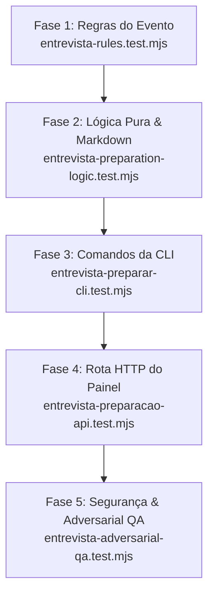

# Arquitetura e Especificação Técnica: Fatia F9.6 — Preparação para Entrevista (`preparar-entrevista`)

> **Status:** Especificação técnica detalhada para implementação via TDD.  
> **Referência de Requisitos:** `<VAULT_ROOT>/.tarefas/career-bounty/PLANO-F9-recursos-2026-10-18.md` (seção F9.6 e regras globais).  
> **Design de Referência:** `docs/design/PAINEL.md` (seção "Preparação para Entrevista").  
> **Branch de Trabalho:** `feat/F9.6-preparacao-entrevista` no repositório `C:\Projetos\career-bounty-backend`.

---

## 1. Visão Geral da Fatia F9.6

A fatia **F9.6** entrega a infraestrutura de backend, contratos e geração do dossiê estratégico de **Preparação para Entrevista** (`preparar-entrevista`):

1. **Objetivo Central:**
   - Capacitar o candidato a chegar a uma entrevista técnica ou com gestor com total clareza dos seus diferenciais factuais, domínio das suas lacunas com estratégias honestas de resposta, histórias estruturadas no padrão **STAR** (Situação, Tarefa, Ação, Resultado) conectadas aos requisitos da oportunidade, e conhecimento exato do que **NÃO alegar** para evitar perda de credibilidade.

2. **Diferenciação Estrita de Conceitos (Sem Quebrar Comandos Existentes):**
   - **`core/kb/interview.mjs` & subcomandos legados de `entrevista` (`lacunas`, `perguntar`, `registrar`, `pendentes`, `aprovar`, `rejeitar`):** Realizam a *entrevista investigativa interna de lacunas*, na qual o agente Opus faz perguntas investigativas sobre buracos ou faltas documentais na base e transforma as respostas em afirmações pendentes do tipo `relato`.
   - **`core/interview/preparation.mjs` & `entrevista preparar` / `preparar-entrevista` (F9.6):** É a ferramenta de *preparação para entrevista de emprego* com empresas recrutadoras externas. **Não misturar nem quebrar** os subcomandos existentes; os comandos legados permanecem estritamente intactos, e a preparação é introduzida como novo subcomando `entrevista preparar` (com alias de topo `preparar-entrevista`).

3. **Os Quatro Pilares do Dossiê de Preparação:**
   - **1. Pontos Fortes:** Requisitos da vaga atendidos com afirmações comprovadas documentalmente (`verificado`, `entregue`).
   - **2. Pontos Fracos e Lacunas:** Requisitos não atendidos (`lacuna` / `nao-atendido`) ou com cobertura parcial (`parcial`), inclusive requisitos rebaixados por ausência de prova documental. Fornece plano de contingência e defesa honesta (transferência de habilidades, rápida curva de aprendizado, projetos análogos).
   - **3. Perguntas Prováveis & Histórias STAR:** Perguntas técnicas e situacionais prováveis para o cargo e mapeamento das histórias e arcos do `story-bank` (`historias`, `arcos`) que respondem a cada pergunta no formato STAR (Situação, Tarefa, Ação, Resultado).
   - **4. O que NÃO alegar:** Lista explícita de afirmações que não devem ser alegadas como fato consolidado (afirmações de nível `relato`, `proposta`, itens com `publicavel: 'nao'` ou termos confidenciais em `anonimizar`), além de lacunas críticas para as quais o candidato deve ter postura de humildade e transparência.

4. **Artefatos e Integrações:**
   - Geração de documento estruturado Markdown persistido em `DATA_ROOT/outbox/entrevistas/entrevista-<vaga_id>-<data>.md`.
   - Subcomando opcional de simulação `entrevista simular --vaga <id>` que gera roteiro interativo para treino de conversa com o assistente Claude.
   - Registro append-only do evento auditável `entrevista.preparada` no log (`events/`).
   - Endpoint HTTP seguro e autenticado no painel local: `GET /api/entrevistas/preparacao?vaga=<id>` com estrito mascaramento de PII e redação de identidade.

---

## 2. Modelo de Dados e Event Sourcing

### 2.1 Evento Append-Only: `entrevista.preparada`

Seguindo o padrão de nomenclatura `entidade.acao` em português e a imutabilidade do log append-only (`core/store/events.mjs`), a emissão da preparação grava o seguinte evento:

```json
{
  "id": "entrevista.preparada:c4b8e21a-6379-4d8e-9d2a-874211029abc",
  "ts": "2026-10-18T16:30:00.000-03:00",
  "host": "saulo-pc",
  "seq": 1042,
  "ator": "usuario",
  "tipo": "entrevista.preparada",
  "entidade": "entrevista",
  "entidade_id": "vaga-corp-tech-01",
  "dados": {
    "vaga_id": "vaga-corp-tech-01",
    "arquivo": "outbox/entrevistas/entrevista-vaga-corp-tech-01-2026-10-18.md",
    "data": "2026-10-18",
    "pontos_fortes_count": 4,
    "lacunas_count": 2
  },
  "evidencia": []
}
```

### 2.2 Validação de Regras de Domínio em `core/store/rules.mjs`

A validação do evento segue as regras estritas do projeto:

```javascript
// core/store/rules.mjs

export function validarEntrevistaPreparada(dados, nowTs = new Date().toISOString()) {
  if (!dados || typeof dados !== 'object' || Array.isArray(dados)) {
    return 'Dados da preparação de entrevista inválidos.';
  }
  if (typeof dados.vaga_id !== 'string' || !dados.vaga_id.trim()) {
    return 'ID da vaga é obrigatório.';
  }
  if (typeof dados.arquivo !== 'string' || !dados.arquivo.trim()) {
    return 'Caminho do arquivo de preparação é obrigatório.';
  }
  if (dados.arquivo.includes('\0') || dados.arquivo.split(/[\\/]/).some(p => p === '..')) {
    return 'Caminho do arquivo de preparação inválido (não pode conter ".." ou caracteres nulos).';
  }
  if (!isoDate(dados.data)) {
    return 'Data da preparação inválida; use AAAA-MM-DD.';
  }
  if (dados.data > localDay(nowTs)) {
    return 'A preparação de entrevista não pode ter data futura.';
  }
  if (!Number.isInteger(dados.pontos_fortes_count) || dados.pontos_fortes_count < 0) {
    return 'Contagem de pontos fortes deve ser um número inteiro >= 0.';
  }
  if (!Number.isInteger(dados.lacunas_count) || dados.lacunas_count < 0) {
    return 'Contagem de lacunas deve ser um número inteiro >= 0.';
  }
  return null;
}
```

### 2.3 Projeção Pura de Entrevistas: `core/store/projections/entrevistas.mjs`

Para consultar de forma reativa e puramente funcional quais vagas já possuem preparações realizadas e histórico, implementa-se `projectEntrevistas`:

```typescript
interface PreparacaoRegistro {
  vaga_id: string;
  arquivo: string;
  data: string;
  pontos_fortes_count: number;
  lacunas_count: number;
  ts: string;
}

interface ProjecaoEntrevistas {
  por_vaga: Record<string, PreparacaoRegistro>;
  historico: PreparacaoRegistro[];
  total_preparadas: number;
}
```

```javascript
// core/store/projections/entrevistas.mjs

export function projectEntrevistas(eventos = [], { now = new Date() } = {}) {
  const historico = [];
  const por_vaga = {};

  for (const ev of eventos) {
    if (ev.tipo !== 'entrevista.preparada' || !ev.dados) continue;
    const reg = {
      vaga_id: ev.dados.vaga_id,
      arquivo: ev.dados.arquivo.replaceAll('\\', '/'),
      data: ev.dados.data,
      pontos_fortes_count: ev.dados.pontos_fortes_count,
      lacunas_count: ev.dados.lacunas_count,
      ts: ev.ts,
    };
    historico.push(reg);
    por_vaga[reg.vaga_id] = reg;
  }

  return {
    por_vaga,
    historico,
    total_preparadas: Object.keys(por_vaga).length,
  };
}
```

---

## 3. Lógica Pura: `core/interview/preparation.mjs`

### 3.1 Assinatura e Contrato da Função Central

A geração da preparação é uma **função puramente determinística** e desacoplada de I/O de rede ou banco de dados:

```typescript
export function gerarPreparacaoEntrevista(params: {
  vaga: Vaga;                     // Vaga do pipeline projetado ou objeto com { id, cargo, empresa, descricao }
  avaliacao?: AvaliacaoVaga;      // Avaliação pré-calculada (opcional se a vaga já trouxer requisitos)
  base: KnowledgeBase;            // Base de conhecimento unificada ({ claims, evidence, historias, arcos, preferencias })
  now?: string | Date;            // Instante de referência para datas (relógio injetável)
}): PreparacaoEntrevista;
```

### 3.2 Estrutura do Dossiê `PreparacaoEntrevista`

```typescript
interface PontoForte {
  requisito: string;
  tipo: 'obrigatorio' | 'desejavel';
  afirmacoes: {
    id: string;
    texto: string;
    nivel_prova: 'verificado' | 'entregue';
    empresa_nome: string | null;
    periodo: string | null;
    evidencias: { id: string; fonte: string; texto: string }[];
  }[];
  orientacao_resposta: string;
}

interface PontoFracoOuLacuna {
  requisito: string;
  tipo: 'obrigatorio' | 'desejavel';
  status_avaliacao: 'parcial' | 'lacuna';
  afirmacoes_relacionadas: {
    id: string;
    texto: string;
    nivel_prova: string;
  }[];
  estrategia_defesa: string;
  postura_recomendada: string;
}

interface PerguntaSTAR {
  id: string;
  pergunta: string;
  categoria: 'tecnica' | 'comportamental' | 'arquitetura' | 'lideranca';
  requisito_associado: string | null;
  historia_id: string | null;
  historia_titulo: string | null;
  star: {
    situacao: string;
    tarefa: string;
    acao: string;
    resultado: string;
  };
  afirmacoes_referenciadas: string[];
  dica_articulacao: string;
}

interface ItemNaoAlegar {
  topico: string;
  motivo_bloqueio: 'sem_prova_documental' | 'afirmacao_relato' | 'nao_publicavel' | 'termo_anonimizar' | 'lacuna_critica';
  detalhe: string;
  recomendacao_humana: string;
}

interface PreparacaoEntrevista {
  vaga_id: string;
  cargo: string;
  empresa_nome: string;
  aderencia: string;
  data: string;
  contadores: {
    pontos_fortes: number;
    pontos_fracos_e_lacunas: number;
    perguntas_star: number;
    itens_nao_alegar: number;
  };
  pontos_fortes: PontoForte[];
  pontos_fracos_e_lacunas: PontoFracoOuLacuna[];
  perguntas_star: PerguntaSTAR[];
  o_que_nao_alegar: ItemNaoAlegar[];
  resumo_estrategico: string;
}
```

### 3.3 Algoritmos de Extração e Matching

#### A. Extração de Pontos Fortes
1. Itera sobre os requisitos avaliados da vaga (`avaliacao.requisitos ?? vaga.requisitos ?? []`).
2. Considera apenas requisitos onde a avaliação for `'atendido'` (ou sem status negativo).
3. Localiza cada ID em `base.claims`.
4. Filtra apenas afirmações cujo `nivel_prova` seja `'verificado'` ou `'entregue'`.
5. Se o requisito não possuir nenhuma afirmação com prova (`verificado` ou `entregue`), ele **NÃO** entra como ponto forte (é tratado na seção de parciais/lacunas conforme regra de prova do `core/score/validate.mjs`).
6. Envia as evidências cruzadas de `base.evidence` que referenciam as afirmações.
7. Produz orientação prática de argumentação baseada em fatos e métricas presentes no texto da afirmação.

#### B. Extração de Pontos Fracos e Lacunas
1. Identifica requisitos onde a avaliação for `'lacuna'`, `'nao-atendido'`, `'parcial'` ou que contenham a flag `nao_verificado: true`.
2. Identifica também requisitos atendidos que foram rebaixados por ausência de prova documental.
3. Para cada item:
   - Determina se é obrigatório ou desejável.
   - Associa as afirmações fracas relacionadas (`relato` ou `proposta`), se houver.
   - Fornece estratégia de defesa realista:
     - *Se for lacuna total:* Orientação para admitir ausência de vivência prática em produção com transparência e apontar rápida curva de aprendizado demonstrada em tecnologias análogas da base.
     - *Se for parcial:* Orientação para destacar a base conceitual adquirida, diferenciando-a claramente de vivência de grande porte.

#### C. Mapeamento de Perguntas Prováveis e Histórias STAR
1. **Histórias e Arcos da Base:**
   - Cada item em `base.historias` e `base.arcos` aponta para uma lista `afirmacoes: ['AF-001', 'AF-002']`.
   - Um requisito da vaga também aponta para afirmações `afirmacoes: ['AF-001', ...]`.
   - **Match de Ouro:** Quando uma história do `story-bank` compartilha uma ou mais afirmações com um requisito avaliado da vaga, essa história é a candidata prioritária para responder à pergunta provável daquele requisito!
2. **Histórias Comportamentais Globais:**
   - Histórias que cobrem competências transversais (conflito técnico, incidente em produção, negociação de escopo, entrega sob pressão) são mapeadas para perguntas situacionais típicas de entrevista comportamental.
3. **Extração das 4 Dimensões STAR:**
   - O corpo da história em markdown (`historia.texto`) é analisado:
     - Se contiver seções explícitas (ex.: `## Situação`, `## Tarefa`, `## Ação`, `## Resultado` ou prefixos equivalentes `Situação:`, `Ação:`), os textos são extraídos diretamente para cada campo de `star`.
     - Caso o markdown não esteja dividido formalmente, a função divide o corpo em parágrafos de forma estruturada, mantendo a integridade e sugerindo o encadeamento oral (Contexto do Desafio -> Responsabilidade Assumida -> Iniciativa e Ações -> Impacto Mensurável).

#### D. Identificação do Bloco "O que NÃO alegar"
1. **Afirmações de Nível Relato ou Proposta:** Todas as afirmações vinculadas à vaga ou ao perfil cujo nível seja `'relato'` ou `'proposto'` são listadas como proibidas de serem alegadas como fatos comprovados.
2. **Flag `publicavel: 'nao'`:** Qualquer afirmação marcada como não publicável gera bloqueio estrito.
3. **Termos sigilosos (`anonimizar`):** Se alguma afirmação possuir a lista `anonimizar`, gera alerta específico: "Nunca mencione o nome do cliente sigiloso [X] ou o sistema proprietário [Y]; refira-se genericamente como 'grande instituição bancária' ou 'plataforma legada de missão crítica'".
4. **Lacunas Críticas:** Requisitos obrigatórios críticos da vaga não atendidos (idiomas, anos de experiência, certificações regulatórias) recebem recomendação enfática de não inventar domínio.

---

### 3.4 Geração de Documento Estruturado em Markdown

A função pura `formatarPreparacaoMarkdown(preparacao)` gera o artefato padronizado em formato Markdown para leitura fluida:

```markdown
# Preparação para Entrevista: {cargo} na {empresa}

- **Vaga ID:** `{vaga_id}`
- **Data de Geração:** `{data}`
- **Aderência Global:** `{aderencia}`
- **Pontos Fortes com Prova:** {contadores.pontos_fortes}
- **Lacunas / Pontos Fracos:** {contadores.pontos_fracos_e_lacunas}
- **Histórias STAR Prontas:** {contadores.perguntas_star}

---

## 1. Pontos Fortes (Comprovações Fatuais)

### 1.1 {requisito} [{tipo}]
- **Afirmações de Sustentação:**
  - `[AF-001]` ({nivel_prova}) {texto_da_afirmacao} (Empresa: {empresa}, Período: {periodo})
    - *Evidência:* {evidencia_id} ({fonte})
- **Orientação de Resposta:** {orientacao_resposta}

---

## 2. Pontos Fracos e Lacunas (Plano de Contingência)

### 2.1 {requisito} [{tipo}] — Status: {status_avaliacao}
- **Diagnóstico:** Requisito não comprovado documentalmente na base.
- **Estratégia de Defesa:** {estrategia_defesa}
- **Postura Recomendada:** {postura_recomendada}

---

## 3. Perguntas Prováveis & Histórias STAR

### 3.1 "{pergunta}"
- **Categoria:** {categoria} | **Requisito Associado:** {requisito}
- **História de Referência:** `{historia_id}` — *{historia_titulo}*
- **Estrutura STAR:**
  - **S (Situação):** {star.situacao}
  - **T (Tarefa):** {star.tarefa}
  - **A (Ação):** {star.acao}
  - **R (Resultado):** {star.resultado}
- **Dica de Articulação:** {dica_articulacao}

---

## 4. O que NÃO alegar (Limites de Credibilidade)

| Tópico | Motivo | Recomendação de Postura |
| :--- | :--- | :--- |
| **{topico}** | `{motivo_bloqueio}` | {recomendacao_humana} |

---
*Dossiê gerado pelo CareerBounty em {data}. Fatos sustentados por evidências; zero conjectura.*
```

### 3.5 Simulação de Entrevista: `gerarRoteiroSimulacao({ preparacao, vaga })`

A função pura `gerarRoteiroSimulacao` compõe um roteiro completo em Markdown para que a pessoa usuária possa copiar e colar ou conduzir um treino com o Claude em sessão interativa:

1. **Instruções de Papel (System Prompt para Claude):** Orientando o modelo a atuar como entrevistador sênior daquela empresa e cargo, mantendo perguntas diretas, cronometrando e avaliando a clareza STAR.
2. **Rodadas Estruturadas de Pergunta:**
   - Rodada 1: Quebra-gelo e trajetória profissional focando nos pontos fortes comprovados.
   - Rodada 2: Desafio técnico profundo nos requisitos principais.
   - Rodada 3: Pergunta de lacuna (avaliando honestidade, integridade e reação sob pressão).
   - Rodada 4: Pergunta comportamental situacional (exigindo resposta em formato STAR).
3. **Rubrica de Autoavaliação:** Critérios claros para julgar o treino (ausência de enrolação, objetividade temporal de 2 a 3 minutos por resposta, confissão limpa da lacuna sem tentar blefar).

### 3.6 Persistência Atômica do Arquivo

A função `salvarPreparacao({ dataRoot, preparacao, vagaId, saida, now })`:
- Determina o nome do arquivo padrão: `entrevista-${slug(vagaId)}-${data}.md` sob `DATA_ROOT/outbox/entrevistas/`.
- Caso `--saida` seja informada, valida caminho seguro (dentro de `DATA_ROOT/outbox/` ou caminho explicitamente fornecido sem `..` e sem links simbólicos).
- Utiliza `gravarProposta(dataRoot, 'entrevistas', nomeArquivo, markdown)` de `core/kb/outbox.mjs` (com escrita atômica via `atomicWriteFile`).
- Retorna o caminho relativo padronizado (`outbox/entrevistas/...`).

---

## 4. Comandos da CLI

### 4.1 `entrevista preparar`

Executa o fluxo completo de preparação para a vaga informada.

```bash
career-bounty entrevista preparar --vaga <id> [--saida <caminho>] [--live] [--replay <arquivo>] [--now <data>] [--json]
```

#### Fluxo Operacional:
1. Carrega configurações (`loadSettings`).
2. Lê eventos do log (`readEvents(settings.dataRoot)`) e obtém as vagas projetadas (`projectEvents(eventos).vagas`).
3. Localiza a vaga informada por `--vaga <id>`. Se não existir, emite erro claro: `Vaga não encontrada: <id>`.
4. **Verificação de Avaliação Prévia:**
   - Se a vaga já possuir `vaga.requisitos` e avaliação válida: utiliza os requisitos existentes diretamente.
   - Se a vaga **NÃO** possuir avaliação no log:
     - Executa o avaliador Sonnet antes (`avaliar({ runner, vaga, afirmacoes })` de `core/score/evaluate.mjs`).
     - Carrega fontes e afirmações da base (`carregarFontes` + `lerBase`).
     - Cria o runner com base nas opções (`--live`, `--replay` ou fake em testes).
     - Grava o evento `vaga.avaliada` no log para persistir a avaliação da vaga de forma idempotente.
5. Carrega a base de conhecimento completa (`lerBase(fontes)`).
6. Executa a função pura `gerarPreparacaoEntrevista({ vaga, avaliacao, base, now })`.
7. Constrói o texto Markdown via `formatarPreparacaoMarkdown(preparacao)`.
8. Salva o arquivo no diretório `DATA_ROOT/outbox/entrevistas/` (ou no caminho especificado por `--saida`).
9. Grava o evento `entrevista.preparada` no log append-only via `appendEvents`.
10. **Saída:**
    - Modo padrão (terminal): exibe cabeçalho, contagem de pontos fortes, contagem de lacunas, perguntas STAR mapeadas e o caminho do arquivo gravado em `outbox/`.
    - Modo `--json`: retorna objeto `{ ok: true, vaga_id, arquivo, pontos_fortes_count, lacunas_count, preparacao }`.

### 4.2 `entrevista simular`

Gera o roteiro de perguntas e diretrizes para simulação de treino.

```bash
career-bounty entrevista simular --vaga <id> [--saida <caminho>] [--now <data>] [--json]
```

#### Fluxo Operacional:
1. Localiza a vaga. Se não tiver avaliação/preparação gerada, executa a preparação automaticamente antes.
2. Invoca `gerarRoteiroSimulacao({ preparacao, vaga })`.
3. Se `--saida` for informada ou por padrão, grava `outbox/entrevistas/simulacao-<vaga>-<data>.md`.
4. Exibe o roteiro completo no console para o usuário iniciar o treino no chat.

### 4.3 Alias de Topo e Preservação de Subcomandos

Em `core/cli/commands.mjs`:
- O subcomando `entrevista` em `core/cli/entrevista.mjs` trata `preparar` e `simular`.
- Os subcomandos legados de entrevista (`lacunas`, `perguntar`, `registrar`, `pendentes`, `aprovar`, `rejeitar`) permanecem **100% inalterados e funcionais**.
- Registra-se adicionalmente o comando de topo `preparar-entrevista`:
  ```javascript
  'preparar-entrevista': async (rest, opts) => commands.entrevista(['preparar', ...rest], opts)
  ```
  garantindo total conformidade com a convenção de invocação rápida.

---

## 5. Rota HTTP no Painel Local

### 5.1 Especificação de Segurança e Transporte

- **Método:** `GET`
- **Caminho:** `/api/entrevistas/preparacao`
- **Autenticação:** Obrigatória via cabeçalho `X-Painel-Token`. Token efêmero validado; se inválido ou ausente, responde `403 Forbidden`.
- **Host e Origem:** Apenas `127.0.0.1` ou `localhost`.
- **Parâmetros de Consulta (Query Strings):**
  - `vaga=<id>` (**obrigatório**): identificador da vaga. Se omitido, retorna `400 Bad Request` com `{ erro: 'Parâmetro "vaga" é obrigatório.' }`.

### 5.2 Validação da Vaga e Estado de Avaliação

1. Lê o log de eventos e reconstrói as vagas do pipeline (`projectEvents(eventos).vagas`).
2. Busca a vaga pelo `id`. Se não encontrada, responde `404 Not Found` (`{ erro: 'Vaga não encontrada: <id>' }`).
3. **Vaga sem avaliação:**
   - Se a vaga existir mas ainda não tiver requisitos avaliados (`!vaga.requisitos || vaga.requisitos.length === 0`):
   - A rota HTTP **não** deve disparar chamadas síncronas pesadas a LLM externo.
   - Devolve status `422 Unprocessable Entity` com:
     `{ erro: 'Vaga ainda não avaliada. Execute "entrevista preparar --vaga <id>" na CLI para gerar a avaliação antes da preparação.' }`.
4. Se a vaga tiver requisitos:
   - Carrega as fontes e a base (`lerBase`).
   - Invoca `gerarPreparacaoEntrevista({ vaga, avaliacao: vaga, base, now: nowTs })`.
   - Gera o markdown via `formatarPreparacaoMarkdown(preparacao)`.
   - Determina o caminho do arquivo (se houver evento `entrevista.preparada` no histórico, reaproveita o caminho persistido; caso contrário, indica o caminho padrão).

### 5.3 Mascaramento Rigoroso de PII e Redação

Para garantir que a resposta HTTP nunca exponha dados de contato sensíveis de recrutadores ou dados pessoais confidenciais:
1. Aplica `mascararTexto` (de `core/privacy/mask.mjs`) recursivamente em todos os campos de texto:
   - Requisitos, orientações de resposta, estratégias de defesa, perguntas prováveis, relatos e detalhes de notas.
2. Carrega a identidade do usuário via `loadIdentityValues({ env: { IDENTITY_FILE: join(dataRoot, 'identity.yml') } })`.
3. Aplica `redact(payload, identidade)` (de `core/privacy/redact.mjs`) em todo o payload antes do envio.

### 5.4 Formato da Resposta (`200 OK`)

```json
{
  "vaga_id": "vaga-corp-tech-01",
  "cargo": "Engenheiro de Software Sênior",
  "empresa": "Empresa Alfa",
  "data": "2026-10-18",
  "aderencia": "alta",
  "contadores": {
    "pontos_fortes": 3,
    "pontos_fracos_e_lacunas": 1,
    "perguntas_star": 2,
    "itens_nao_alegar": 2
  },
  "pontos_fortes": [
    {
      "requisito": "Experiência em arquitetura de microsserviços Node.js",
      "tipo": "obrigatorio",
      "afirmacoes": [
        {
          "id": "AF-001",
          "texto": "Projetou arquitetura orientada a eventos para microsserviços Node.js",
          "nivel_prova": "verificado",
          "empresa": "Empresa Alfa",
          "periodo": "2022-2024",
          "evidencias": [
            {
              "id": "EV-001",
              "fonte": "docs/arquitetura.md",
              "texto": "Documento técnico de arquitetura aprovado"
            }
          ]
        }
      ],
      "orientacao_resposta": "Destaque a transição para microsserviços e métricas de latência obtidas."
    }
  ],
  "pontos_fracos_e_lacunas": [
    {
      "requisito": "Domínio avançado de Kubernetes e orquestração em nuvem",
      "tipo": "obrigatorio",
      "status_avaliacao": "lacuna",
      "afirmacoes_relacionadas": [],
      "estrategia_defesa": "Admitir que o gerenciamento de clusters ficava a cargo da equipe de DevOps; enfatizar a capacidade comprovada de escrita de manifests e deploys.",
      "postura_recomendada": "Transparência total; direcionar para solidez no ciclo de vida de contêineres."
    }
  ],
  "perguntas_star": [
    {
      "id": "pergunta-star-1",
      "pergunta": "Conte sobre uma situação em que você precisou otimizar o desempenho de um microsserviço crítico.",
      "categoria": "tecnica",
      "requisito_associado": "Experiência em arquitetura de microsserviços Node.js",
      "historia_id": "historia-otimizacao-cache",
      "historia_titulo": "Refatoração do pipeline de dados com Redis",
      "star": {
        "situacao": "Latência no checkout atingindo 800ms em horários de pico.",
        "tarefa": "Reduzir o tempo de resposta p95 para menos de 150ms sem elevar custos de infraestrutura.",
        "acao": "Implementou camada de cache semântico em Node.js com invalidação por eventos.",
        "resultado": "Queda da latência p95 para 92ms e suporte a 3x mais requisições por segundo."
      },
      "afirmacoes_referenciadas": ["AF-001"],
      "dica_articulacao": "Quantifique a melhoria com os números exatos e mencione a estabilidade após a entrega."
    }
  ],
  "o_que_nao_alegar": [
    {
      "topico": "Administração de clusters Kubernetes em produção",
      "motivo_bloqueio": "lacuna_critica",
      "detalhe": "Requisito identificado como lacuna técnica na avaliação da vaga.",
      "recomendacao_humana": "Nunca afirme que administrou clusters produtivos. Limite-se a manifestos e uso de contêineres."
    },
    {
      "topico": "AF-089 (Migração de banco legado)",
      "motivo_bloqueio": "afirmacao_relato",
      "detalhe": "Afirmação em nível de relato sem evidência documental associada.",
      "recomendacao_humana": "Use apenas como contexto qualitativo secundário; não fundamente promessas técnicas nessa alegação."
    }
  ],
  "resumo_estrategico": "Vaga com forte aderência técnica em backend. O foco central da entrevista deve ser a experiência sólida em microsserviços, adotando postura de humildade quanto a infraestrutura e DevOps.",
  "markdown": "# Preparação para Entrevista: Engenheiro de Software Sênior na TechCorp Soluções\n\n...",
  "arquivo": "outbox/entrevistas/entrevista-vaga-corp-tech-01-2026-10-18.md"
}
```

---

## 6. Documentação Complementar

### 6.1 `docs/PAINEL-API.md` (Seção 8)
- Adicionar documentação completa do endpoint `GET /api/entrevistas/preparacao`:
  - Propósito e política de privacidade.
  - Parâmetros de consulta (`vaga`).
  - Respostas `200 OK` (com payload JSON e Markdown renderizável com dados sintéticos), `400 Bad Request`, `403 Forbidden`, `404 Not Found` e `422 Unprocessable Entity`.

### 6.2 `docs/GLOSSARY.md`
- Inserir as novas definições:
  - **Preparação para entrevista:** Dossiê estratégico estruturado em quatro blocos (pontos fortes comprovados, pontos fracos e lacunas com plano de contingência, perguntas prováveis com histórias STAR e limites do que não alegar) gerado para uma vaga canônica específica.
  - **História STAR:** Estrutura narrativa dividida em Situação, Tarefa, Ação e Resultado ancorada exclusivamente em afirmações comprovadas da base de conhecimento, formatada para articulação oral objetiva em entrevistas.
  - **Evento `entrevista.preparada`:** Registro imutável no log append-only que comprova a compilação e arquivamento do dossiê de preparação de entrevista para uma vaga.
  - **Simulação de entrevista:** Roteiro estruturado de perguntas graduadas (quebra-gelo, técnica, lacuna e comportamental) para treinamento interativo da pessoa com assistente LLM.

### 6.3 `CHANGELOG.md`
- Adicionar entrada detalhada em `## [Unreleased]` sob a seção `### Adicionado`.

---

## 7. Roteiro de Implementação TDD Passo a Passo

O desenvolvimento da fatia F9.6 é realizado estritamente em **TDD (Red -> Green -> Refactor)**, com 5 suítes de testes unitários independentes:



---

### Fase 1: Validação de Regras do Evento (`tests/unit/entrevista-rules.test.mjs`)
- **Teste 1.1:** Aceita dados válidos de evento `entrevista.preparada` com contadores inteiros e arquivo relativo padronizado.
- **Teste 1.2:** Rejeita `vaga_id` ausente, nulo ou vazio.
- **Teste 1.3:** Rejeita `arquivo` com tentativa de path traversal (`..`), caractere nulo ou vazio.
- **Teste 1.4:** Rejeita `data` com formato inválido ou data futura no fuso de São Paulo (`localDay`).
- **Teste 1.5:** Rejeita `pontos_fortes_count` ou `lacunas_count` negativos, não inteiros ou não numéricos.
- **Implementação:** Adicionar `validarEntrevistaPreparada` em `core/store/rules.mjs`.

---

### Fase 2: Lógica Pura e Geração de Markdown (`tests/unit/entrevista-preparation-logic.test.mjs`)
- **Teste 2.1:** Separação precisa de Pontos Fortes:
  - Requisito atendido com afirmação `verificado` vira ponto forte com evidência.
  - Requisito atendido com afirmação `entregue` vira ponto forte.
  - Requisito atendido sustentado apenas por `relato` ou `proposto` **NÃO** vira ponto forte.
- **Teste 2.2:** Separação precisa de Pontos Fracos e Lacunas:
  - Requisito com status `lacuna` ou `nao-atendido` entra como ponto fraco com orientação transparente de humildade.
  - Requisito parcial entra com postura de mitigação e transferência de habilidades.
  - Requisito com flag `nao_verificado: true` é sinalizado.
- **Teste 2.3:** Matching inteligente de Histórias STAR do `story-bank`:
  - História com afirmação comum ao requisito da vaga é vinculada à pergunta provável daquele requisito.
  - Extração correta dos blocos STAR (Situação, Tarefa, Ação, Resultado) a partir do markdown da história.
  - Histórias transversais geram perguntas comportamentais válidas.
- **Teste 2.4:** Formação do bloco "O que NÃO alegar":
  - Afirmações com nível `relato` ou `proposta` entram na lista com motivo `afirmacao_relato` ou `sem_prova_documental`.
  - Afirmações com `publicavel: 'nao'` entram com `nao_publicavel`.
  - Afirmações com lista `anonimizar` geram alertas de anonimização estrita.
  - Lacunas técnicas críticas recebem recomendação de não blefar.
- **Teste 2.5:** Formatação Markdown (`formatarPreparacaoMarkdown`):
  - Gera documento completo contendo as seções 1, 2, 3 e 4 formatadas com títulos legíveis e tabela de bloqueios.
- **Teste 2.6:** Roteiro de simulação (`gerarRoteiroSimulacao`):
  - Gera prompt para Claude, rodadas 1 a 4 de perguntas e critérios de avaliação do treino.
- **Implementação:** Criar `core/interview/preparation.mjs`.

---

### Fase 3: Comandos da CLI (`tests/unit/entrevista-preparar-cli.test.mjs`)
- **Teste 3.1:** `entrevista preparar --vaga <id>` com vaga já avaliada no log:
  - Gera o arquivo `.md` em `DATA_ROOT/outbox/entrevistas/`.
  - Grava o evento `entrevista.preparada` no log append-only.
  - Retorna resumo textual e código de saída 0.
- **Teste 3.2:** `entrevista preparar --vaga <id>` com vaga **NÃO** avaliada:
  - Detecta ausência de avaliação prévia.
  - Dispara o avaliador com o runner configurado (fake/replay).
  - Grava o evento `vaga.avaliada` no log.
  - Conclui a preparação e grava o evento `entrevista.preparada`.
- **Teste 3.3:** `entrevista preparar` para vaga inexistente:
  - Falha com mensagem amigável `Vaga não encontrada: <id>` e status diferente de zero.
- **Teste 3.4:** Suporte a `--saida` customizada com validação de caminho seguro.
- **Teste 3.5:** Suporte a saída estruturada com `--json`.
- **Teste 3.6:** `entrevista simular --vaga <id>`:
  - Gera e imprime o roteiro de simulação.
- **Teste 3.7:** Não quebra nem altera os comandos legados:
  - `entrevista lacunas` e `entrevista pendentes` continuam funcionando normalmente.
- **Teste 3.8:** Alias de topo `preparar-entrevista --vaga <id>` opera identicamente a `entrevista preparar`.
- **Implementação:** Atualizar `core/cli/entrevista.mjs` e `core/cli/commands.mjs`.

---

### Fase 4: Endpoint HTTP no Painel (`tests/unit/entrevista-preparacao-api.test.mjs`)
- **Teste 4.1:** `GET /api/entrevistas/preparacao?vaga=<id>` com token válido:
  - Retorna `200 OK` com payload estruturado em JSON e campo `markdown`.
- **Teste 4.2:** Rejeição de requisição sem token ou com token inválido com `403 Forbidden`.
- **Teste 4.3:** Rejeição de requisição sem query param `vaga` com `400 Bad Request`.
- **Teste 4.4:** Retorno `404 Not Found` quando a vaga não existe no log.
- **Teste 4.5:** Retorno `422 Unprocessable Entity` quando a vaga não foi avaliada previamente.
- **Teste 4.6:** Mascaramento e Redação de PII:
  - Telefones e e-mails de recrutadores presentes em observações são mascarados.
  - Dados sensíveis de identidade do usuário nunca aparecem na resposta JSON nem no Markdown.
- **Implementação:** Adicionar a rota em `panel/server.mjs`.

---

### Fase 5: Segurança e Adversarial QA (`tests/unit/entrevista-adversarial-qa.test.mjs`)
- **Teste 5.1:** Tentativa de Path Traversal no parâmetro `--saida` (ex: `../../etc/passwd` ou `..\malicious.md`):
  - Deve ser rejeitada com erro de caminho inseguro.
- **Teste 5.2:** Vaga com requisitos com arrays vazios ou campos inesperados:
  - Lógica pura deve processar de forma resiliente sem disparar exceções não tratadas.
- **Teste 5.3:** Base de conhecimento sem histórias ou sem arcos:
  - Degradação graciosa: a seção de histórias STAR apresenta perguntas prováveis técnicas mesmo sem histórias pré-cadastradas no `story-bank`.
- **Teste 5.4:** Tentativa de injeção de prompt ou conteúdo malicioso na descrição da vaga:
  - O markdown gerado sanitiza caracteres de controle e delimitações impróprias.
- **Teste 5.5:** Conferência de monotonicidade e determinismo:
  - Mesmas entradas geram rigorosamente o mesmo JSON e Markdown.

---

## 8. Critérios de Aceite e Verificação

Para considerar a fatia F9.6 concluída com êxito:
1. Todos os testes unitários novos das 5 fases implementados e verdes.
2. `npm test -- --test-concurrency=4` executando 100% verde sem nenhuma falha ou skip.
3. `node bin/career-bounty.mjs privacy scan --all` aprovado com 0 achados de PII.
4. `node bin/career-bounty.mjs plugin validate` aprovado.
5. Arquivos de documentação atualizados:
   - `docs/PAINEL-API.md` (Seção 8)
   - `docs/GLOSSARY.md`
   - `CHANGELOG.md`
6. Nenhuma dependência npm nova introduzida no `package.json`.
7. Registro da fatia documentado no log de auditoria `<VAULT_ROOT>/.tarefas/career-bounty/F9-LOG.md`.
